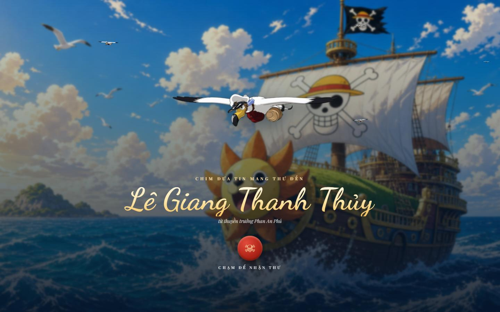
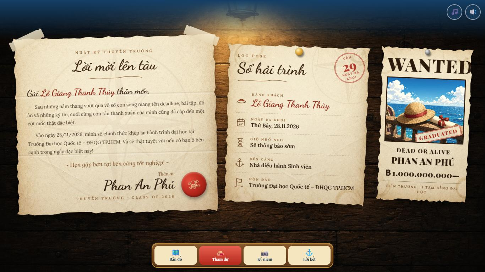
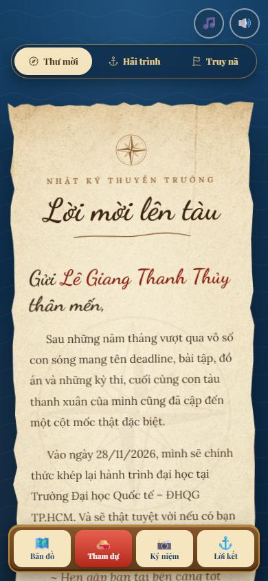
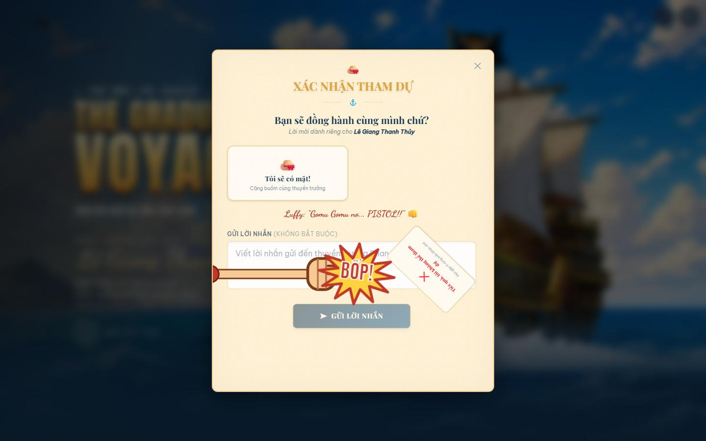
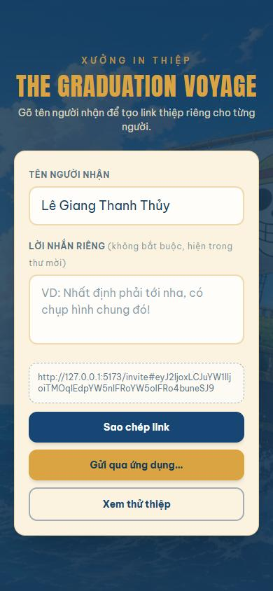

<div align="center">

# 🏴‍☠️ THE GRADUATION VOYAGE

### Hành Trình Đến Tân Thế Giới

**Thiệp mời tốt nghiệp tương tác theo phong cách One Piece**
của **Phan An Phú** – Trường Đại học Quốc tế, ĐHQG TP.HCM · Class of 2026

*“Một hành trình kết thúc, một hành trình mới bắt đầu!”*




</div>

---

## ⚓ Giới thiệu

Bốn năm đại học là một chuyến hải trình: vượt qua những con sóng mang tên deadline, đồ án và mùa thi để cập bến tốt nghiệp. **The Graduation Voyage** biến tấm thiệp mời giấy quen thuộc thành một trải nghiệm web hoàn chỉnh – nơi mỗi người bạn nhận được *một bức thư riêng mang tên mình*, do chim đưa tin bay tới, mở ra trên vách khoang tàu của băng hải tặc Mũ Rơm.

Đây là sản phẩm cá nhân mình tự hào hoàn thiện ở thời điểm khép lại quãng đời sinh viên: từ ý tưởng, kịch bản trải nghiệm, hình ảnh, cho tới từng chuyển động nhỏ và việc đưa lên mạng để gửi tới bạn bè.

## ✨ Điểm nổi bật

| | |
|---|---|
| 🕊️ **Mở đầu điện ảnh** | Chim đưa tin News Coo sà xuống trao thư, tàu Thousand Sunny lướt sóng phía sau, tên khách hiện lên lấp lánh. |
| 📜 **Bảng hải trình trên vách tàu** | *Lời mời lên tàu*, *Sổ hải trình (Log Pose)* và *Lệnh truy nã* gộp chung một màn hình, ghim bằng băng dính, đinh ghim, đinh sắt – có đổ bóng, đung đưa và nghiêng theo con trỏ như giấy thật. |
| 🗺️ **Bản đồ kho báu** | Đường đi nét đứt tự vẽ tới dấu X, đồng hồ đếm ngược dạng lật số, mở chỉ đường Google Maps và thêm vào lịch (Google Calendar / file `.ics`). |
| 👒 **Trò đùa Gomu Gomu** | Rê chuột gần nút *“không tham dự”*? Cánh tay cao su của Luffy sẽ thong thả kéo nút đi chỗ khác – tới lần thứ tư thì tung **“Gomu Gomu no… PISTOL!!”** đấm văng nút vào góc. |
| 📸 **Kỷ niệm & Lời kết** | Album ảnh hành trình và lá thư cảm ơn *“Thank you, Nakama!”* dưới hoàng hôn. |
| 🔗 **Link riêng cho từng người** | Trang tạo link: gõ tên + lời nhắn → có ngay link `…/invite#…` để gửi qua Zalo, Messenger. Không cần máy chủ hay cơ sở dữ liệu. |
| 📱 **Mọi thiết bị** | Bố cục riêng cho laptop, máy tính bảng, điện thoại dọc và điện thoại xoay ngang; tôn trọng chế độ *giảm chuyển động*. |

<div align="center">



| Điện thoại | Gomu Gomu no Pistol! | Tạo link mời |
|:---:|:---:|:---:|
|  |  |  |

</div>

## 🧭 Cách gửi thiệp

1. Mở trang chủ của web.
2. Gõ **tên người nhận** và (nếu muốn) **một lời nhắn riêng**.
3. Bấm **Sao chép link** hoặc **Gửi qua ứng dụng…** rồi gửi cho bạn bè.

Toàn bộ thông tin nằm trong phần sau dấu `#` của link (JSON được mã hoá base64url), nên link không bị cắt khi có dấu tiếng Việt và khoảng trắng, cũng không gửi dữ liệu khách lên máy chủ.

## 🛠️ Công nghệ

- **React 19 + TypeScript + Vite 6** – nền tảng ứng dụng.
- **Tailwind CSS 4** – giao diện, kèm biến thể tuỳ chỉnh cho màn hình ngang / màn hình thấp.
- **Motion** – toàn bộ hoạt cảnh: spring, MotionValue, cử chỉ vuốt, hiệu ứng theo cuộn.
- **Lenis** – cuộn mượt · **canvas-confetti** – pháo giấy khi xác nhận tham dự.
- **Vitest** – kiểm thử các hàm xử lý ngày giờ, lịch, link mời.
- **Supabase** *(tuỳ chọn)* – lưu phản hồi tập trung và trang quản trị khách mời.
- **Vercel** – triển khai, tự cập nhật mỗi lần đẩy code.

Hoạt cảnh chỉ dùng `transform` / `opacity` để giữ mượt ~60fps cả trên điện thoại.

## 🚀 Chạy trên máy

```bash
npm install
npm run dev       # http://localhost:5173
npm test          # chạy kiểm thử
npm run build     # bản build trong thư mục dist/
```

Thông tin buổi lễ (tên, ngày, giờ, địa điểm, lời thư) nằm ở [`src/lib/config.ts`](src/lib/config.ts). Hướng dẫn thay ảnh và nhạc nền: [`CHUAN_BI_ANH.md`](CHUAN_BI_ANH.md).

## 📂 Cấu trúc

```
src/
├── components/scenes/   # Các cảnh: mở đầu, bảng hải trình, bản đồ, tham dự, kỷ niệm, lời kết
├── components/ui/       # Thành phần dùng chung: popup, thanh điều hướng, hoạ tiết mực
├── hooks/               # Khách mời, đếm ngược, nhạc nền, cuộn mượt
├── lib/                 # Cấu hình, link mời, lịch, lưu trữ
└── pages/               # Trang tạo link, trang thiệp, trang quản trị
public/images/           # Ảnh minh hoạ theo từng cảnh
```

## 🤝 Đội ngũ

| | |
|---|---|
| **Phan An Phú** | Ý tưởng, kịch bản trải nghiệm, định hướng hình ảnh, code và hoàn thiện sản phẩm. |
| **Cursor** | Người bạn đồng hành cực giỏi – cùng mình code, tinh chỉnh từng hoạt cảnh và gỡ từng lỗi nhỏ suốt chuyến hải trình. |

---

<div align="center">

*Hẹn gặp bạn tại bến cảng tốt nghiệp — 28.11.2026* ⚓

<sub>Dự án cá nhân, phi thương mại, lấy cảm hứng từ One Piece của Eiichiro Oda. Mọi bản quyền nhân vật thuộc về tác giả và Shueisha / Toei Animation.</sub>

</div>
