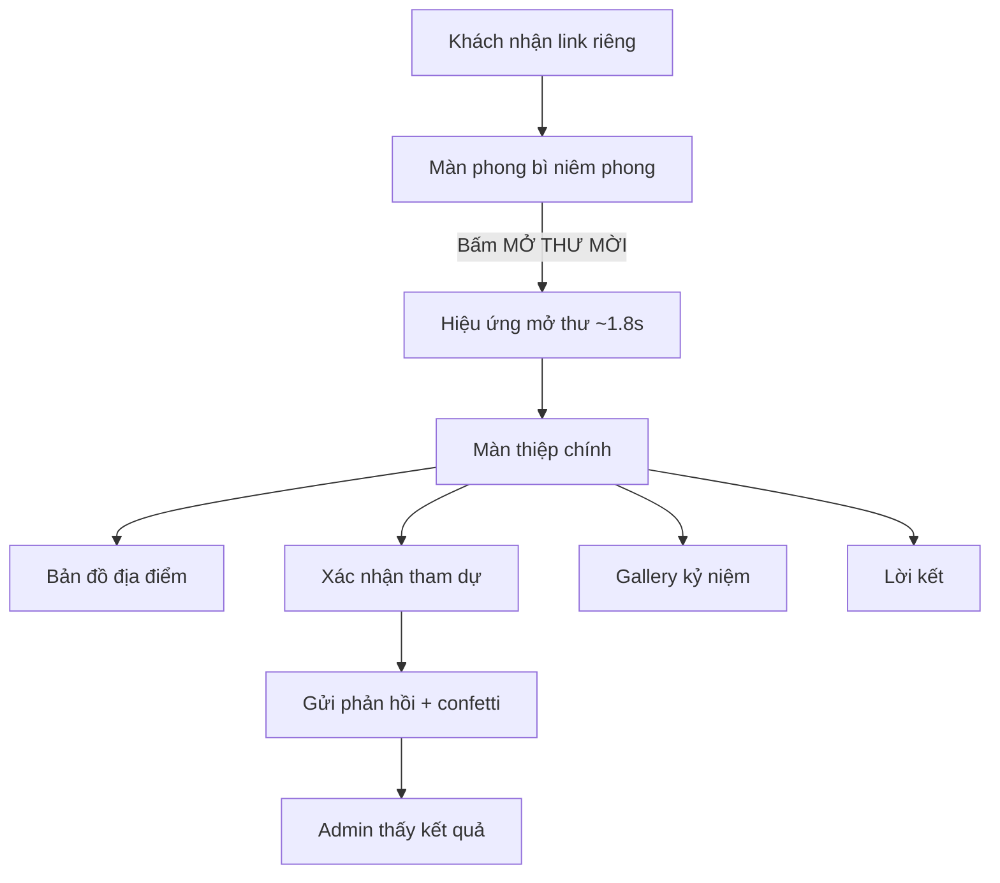

# TÀI LIỆU THIẾT KẾ — THE GRADUATION VOYAGE
### Thiệp mời tốt nghiệp dạng web, phong cách One Piece

| Mục | Nội dung |
|---|---|
| Chủ thiệp | Phan An Phú |
| Sự kiện | Lễ tốt nghiệp — **28/11/2026** |
| Địa điểm | Nhà điều hành Sinh viên, Trường ĐH Quốc tế – ĐHQG TP.HCM |
| Tên dự án / Tagline | THE GRADUATION VOYAGE — "Hành Trình Đến Tân Thế Giới" |
| Phiên bản tài liệu | 1.0 (trước khi code đợt hoàn thiện) |
| Trạng thái | Cần bạn duyệt mục 15 (câu hỏi mở) trước khi code |

> Tài liệu này dựa trên **mã nguồn hiện có trong thư mục `Invitation/`** (React 19 + Vite + Tailwind 4 + Motion + Supabase tùy chọn). Dự án đã có bản khung chạy được; tài liệu này chốt lại yêu cầu, chỉ ra các điểm còn thiếu/sai, và đề ra kế hoạch hoàn thiện.

---

## 1. Mục tiêu

### 1.1 Mục tiêu chính
Khi bạn bè mở link, họ thấy ngay một **tấm thiệp tương tác theo phong cách One Piece**: bạn là "thuyền trưởng", ngày tốt nghiệp là "bến cảng", mỗi bạn bè nhận một lá thư mời có **tên riêng**.

### 1.2 Tiêu chí thành công
1. Bạn bè mở link trên **điện thoại** (≥ 80% khách) và thấy thiệp đẹp, đọc được, không bị vỡ layout.
2. Trong ≤ 10 giây từ lúc mở link, khách biết được: **Ngày – Giờ – Địa điểm**.
3. Khách có thể **bấm xác nhận tham dự** trong ≤ 3 thao tác, và bạn xem được danh sách trả lời.
4. Tải lần đầu < 3 giây trên 4G; hoạt động tốt trên iOS Safari, Chrome Android.
5. Khi gửi link qua Zalo/Messenger/Facebook, **hiện ảnh xem trước (OG image)** đẹp, đúng tên.

### 1.3 Ngoài phạm vi
- Không bán vé, không thanh toán, không đăng nhập cho khách.
- Không phải trang công khai; chỉ chia sẻ cho người được mời.

---

## 2. Đối tượng người dùng

| Vai trò | Mô tả | Nhu cầu chính |
|---|---|---|
| **Khách mời** | Bạn bè, gia đình, thầy cô; chủ yếu dùng điện thoại | Xem thông tin, xác nhận tham dự, xem kỷ niệm |
| **Thuyền trưởng (Admin)** | Chỉ mình bạn | Tạo link riêng cho từng khách, cập nhật giờ/địa điểm, quản lý ảnh, xem ai đã trả lời |

---

## 3. Ý tưởng sáng tạo (Concept)

**Chủ đề:** Tốt nghiệp = kết thúc một chặng hải trình, bước vào *Tân Thế Giới*.

| Yếu tố đời thực | Ẩn dụ One Piece |
|---|---|
| Bạn (chủ thiệp) | Thuyền trưởng, đội mũ rơm |
| Khách mời | Thuyền viên / bạn đồng hành |
| Thiệp mời | Thư mời niêm phong sáp đỏ, giấy da cổ |
| Địa điểm | Bản đồ kho báu / đảo đích |
| Xác nhận tham dự | "Lên thuyền cùng thuyền trưởng" (mũ rơm) |
| Ảnh kỷ niệm | Nhật ký hải trình |
| Lời kết | Hoàng hôn trên con tàu |
| Đếm ngược | Còn bao lâu nữa cập bến |

**Giọng văn:** thân mật, hài hước nhẹ, trẻ trung; xưng "mình", gọi "bạn".

> **Lưu ý bản quyền:** Nhân vật/hình ảnh One Piece thuộc sở hữu của Eiichiro Oda / Shueisha / Toei. Sản phẩm là **fan-made, phi thương mại, chia sẻ riêng tư** cho bạn bè. Không đặt trang lên chỗ công khai, không thu phí, không chạy quảng cáo.

---

## 4. Luồng người dùng (User Flow)



### Sơ đồ trang (Sitemap)

| Route | Mục đích | Ai dùng |
|---|---|---|
| `/` | Trang giới thiệu nhỏ, nút "Xem thiệp mời" | Dự phòng |
| `/invite` | Thiệp chung (tên "Bạn") | Khách chưa có link riêng |
| `/invite?to=Tên` | Thiệp có tên, không cần backend | Gửi nhanh |
| `/invite/:inviteId` | **Thiệp cá nhân hóa** (tên + lời nhắn riêng + lưu RSVP) | Khách mời chính thức |
| `/admin` | Bảng quản trị | Chỉ bạn |

---

## 5. Đặc tả từng màn hình

### 5.1 Màn 1 — Phong bì niêm phong (`PirateEnvelope`)
- Nền biển đêm gradient navy, trăng, sóng SVG chuyển động, ~25 hạt vàng lấp lánh.
- Tiêu đề **"THƯ MỜI ĐẶC BIỆT"**; phong bì giấy da, viền vàng, **dấu sáp đỏ ⚓**.
- Chữ trên phong bì: *"Gửi đến {Tên khách}"* và *"Được gửi từ thuyền trưởng Phan An Phú"*.
- Nút vàng **"⚓ MỞ THƯ MỜI"** → nắp mở (0.6s) → lá thư trượt lên → chuyển màn (~1.8s).
- **Yêu cầu bổ sung:** hiệu ứng nghiêng/lắc nhẹ dẫn dụ bấm; chạm vào chính phong bì cũng mở được; có nút "Bỏ qua hiệu ứng" khi bật *reduced motion*.

### 5.2 Màn 2 — Thiệp chính (`MainInvitationScreen`) ⭐ màn quan trọng nhất
Bố cục nền toàn màn hình với tranh minh họa One Piece: Going Merry, Luffy cùng băng Mũ Rơm vây quanh bạn trong áo cử nhân.

**Desktop / ngang (≥ 1024px)** — 2 cột + thanh điều hướng dưới:

| Khu vực | Nội dung |
|---|---|
| Trái | **Cuộn giấy da lời mời**: "THE GRADUATION VOYAGE" → *"Một lời mời từ Tân Thế Giới"* → *"Gửi đến {Tên},"* → (lời nhắn riêng nếu có) → 2 đoạn thư → *"Hẹn gặp bạn tại bến cảng tốt nghiệp!"* → chữ ký **Phan An Phú — CLASS OF 2026** |
| Phải trên | Bảng gỗ nghiêng: *"Một hành trình kết thúc, một hành trình mới bắt đầu!"* |
| Phải giữa | **Thẻ thông tin sự kiện**: 📅 28.11.2026 · 🕐 Giờ · 📍 Địa điểm · 🏫 Trường |
| Phải dưới | Huy hiệu **GRADUATED ☠️** (mũ rơm) |
| Trên cùng | Trái: nút 🧭 "Thuyền trưởng" → `/admin`; Phải: 🎵 nhạc, 🔊 tắt/bật tiếng |
| Dưới cùng | 4 bảng gỗ điều hướng: 🗺️ Bản đồ · 👒 Xác nhận · 📸 Gallery · ⚓ Lời kết |

**Mobile / dọc (< 768px)** — **chưa được thiết kế đúng trong bản hiện tại, cần làm mới** (xem mục 8).

### 5.3 Popup 1 — Bản đồ địa điểm (`TreasureMap`)
- Ảnh bản đồ kho báu, ghim 📍 nhấp nhô ghi tên địa điểm.
- Lưới 4 ô: Ngày · Thời gian · Địa điểm · Trường.
- Nút **"Xem trên Google Maps"** (mở tab mới, dùng `mapsLink` từ cấu hình).
- **Đồng hồ đếm ngược** ngày:giờ:phút:giây; khi hết hạn: *"Ngày tốt nghiệp đã đến! Chúc mừng tân cử nhân!"*.
- Bổ sung: nút **"Thêm vào lịch"** (tạo file `.ics` / link Google Calendar).

### 5.4 Popup 2 — Xác nhận tham dự (`RSVPSection`)
- Câu hỏi: *"Bạn sẽ đồng hành cùng mình chứ?"* — *Lời mời dành riêng cho {Tên}*.
- 2 lựa chọn: **👒 Tôi sẽ có mặt!** / **✕ Tiếc quá, tôi không thể tham dự**.
- Ô lời nhắn (không bắt buộc) → nút **GỬI LỜI NHẮN**.
- Thành công: confetti (nếu tham dự) + lời cảm ơn + nút "Chỉnh sửa lại phản hồi".
- Tự điền lại câu trả lời cũ nếu khách mở lại.
- Bổ sung: hiển thị lỗi khi gửi thất bại (hiện chỉ `console.error`), giới hạn độ dài lời nhắn (500 ký tự), tùy chọn **số người đi cùng** (nếu bạn muốn, xem mục 15).

### 5.5 Popup 3 — Gallery kỷ niệm (`MemoriesGallery`)
- Carousel kiểu Polaroid: ảnh 4:3, caption chữ viết tay, nút ‹ ›, chấm phân trang, dải ảnh nhỏ.
- Ảnh lấy từ quản trị; nếu chưa có thì dùng ảnh mẫu.
- Bổ sung: vuốt (swipe) trên điện thoại, bấm ảnh để xem toàn màn hình, lazy-load.

### 5.6 Popup 4 — Lời kết (`ClosingScene`)
- Nền hoàng hôn trên tàu, các dòng chữ xuất hiện lần lượt, chữ ký viết tay *Phan An Phú — CLASS OF 2026*.
- Bổ sung: nút "Chia sẻ" / "Quay lại thiệp".

### 5.7 Khung popup (`OverlayModal`)
- Khung da, tiêu đề + icon, đóng bằng nút ✕, nhấp nền, phím **Esc**; khóa cuộn nền; focus trap; animation scale-fade.

### 5.8 Trang quản trị (`/admin`)
Gồm 3 tab:

| Tab | Chức năng |
|---|---|
| 👥 Khách mời | Thêm/sửa/xóa, nhóm (bạn bè/gia đình/thầy cô/đặc biệt), lời nhắn riêng, **sao chép link riêng**, thu hồi link, xem trạng thái RSVP + lời nhắn |
| ⚙️ Cài đặt | Giờ làm lễ, địa điểm, link Google Maps, ảnh chân dung, ảnh OG, nhạc nền |
| 🖼️ Gallery | Tải ảnh lên, caption, sắp xếp thứ tự, xóa |

---

## 6. Hệ thống thiết kế (Design System)

### 6.1 Bảng màu (đã có trong `src/styles/index.css`)

| Token | Mã | Dùng cho |
|---|---|---|
| `navy` | `#183A59` | Nền tối, chữ chính, nút |
| `navy-light` | `#2C5F8A` | Phụ |
| `treasure-gold` | `#D9A441` | Viền, nhấn, tiêu đề trên nền tối |
| `gold-light` | `#F0C96E` | Hover, highlight |
| `parchment` | `#FFF2D5` | Giấy da, phong bì |
| `parchment-dark` | `#F0DDB0` | Gradient giấy |
| `ocean-blue` / `ocean-deep` | `#3B82C4` / `#1A5276` | Biển, sóng |
| `sunny-sky` | `#A8DDF5` | Trời |
| `coral` | `#D96352` | Từ chối, nhấn đỏ |
| Nâu gỗ | `#8B5A2B` | Chữ phụ trên giấy da |
| Đỏ sáp | `#C0392B` | Dấu sáp, tên khách |

### 6.2 Phông chữ

| Vai trò | Font | Ghi chú |
|---|---|---|
| Tiêu đề | **Playfair Display** | Hỗ trợ tiếng Việt |
| Nội dung | **Be Vietnam Pro** | Dễ đọc trên mobile |
| Chữ viết tay | **Dancing Script** | Tên, chữ ký, caption. **Cần kiểm tra dấu tiếng Việt** (Dancing Script hỗ trợ hạn chế một số tổ hợp dấu) → dự phòng *Pacifico / Charm / Be Vietnam Pro italic* |

Cỡ chữ nội dung thư tối thiểu **14px** trên mobile (hiện đang `text-xs` = 12px → quá nhỏ).

### 6.3 Thành phần UI
- **Giấy da:** gradient `#FBF2DC → #ECD3A5`, viền vàng `#C89B3C`, nhiễu giấy nhẹ.
- **Bảng gỗ điều hướng:** gradient be, viền vàng, 4 đinh tán góc, icon tròn navy.
- **Nút chính:** gradient vàng chữ navy (mở thư) hoặc gradient navy viền vàng (gửi).
- **Bo góc:** 8–16px; **bóng:** nhiều lớp, nhẹ trên nền sáng.

### 6.4 Chuyển động
| Hiệu ứng | Thời lượng | Ghi chú |
|---|---|---|
| Mở phong bì | 0.6s nắp + 0.8s thư | Tổng ~1.8s |
| Vào màn chính | 0.7s, trượt từ trái/phải | Delay 0.2s cho cột phải |
| Thanh điều hướng | 0.4s, stagger 0.1s | |
| Popup | 0.25–0.3s | scale + fade |
| Confetti RSVP | 1 lần | Màu vàng/navy/đỏ/xanh |
| Sóng/lấp lánh | lặp | Tắt khi `prefers-reduced-motion` |

---

## 7. Tài sản hình ảnh & âm thanh

### 7.1 Hiện có (`public/images/`)
`main-mockup-bg.jpg`, `btn-map/rsvp/gallery/closing.png`, `popup-*-sample.jpg`, `treasure-island-map.jpg`, `gallery-sample.jpg`, `sunset-ship.jpg`.

### 7.2 ⚠️ Vấn đề lớn nhất của tài sản hiện tại
`main-mockup-bg.jpg` là **ảnh mockup đã in sẵn chữ** (cuộn thư, bảng ngày giờ, nút điều hướng, "GRADUATED"). Trong khi đó code lại **vẽ thêm HTML chồng lên** các phần này → khi chạy sẽ bị **chữ đôi, lệch vị trí, không đổi được tên khách/giờ**, và chữ trong ảnh sẽ mờ khi phóng to trên mobile.

**Giải pháp bắt buộc:** chuẩn bị ảnh nền **sạch (không chữ, không cuộn thư, không bảng thông tin)**, chỉ gồm: bầu trời + Going Merry + băng Mũ Rơm + bạn. Mọi chữ do HTML đảm nhiệm.

### 7.3 Danh sách tài sản cần có

| # | Tài sản | Kích thước gợi ý | Trạng thái |
|---|---|---|---|
| 1 | Nền chính **ngang, sạch chữ** | 2560×1440 (WebP + JPG dự phòng) | ❌ Cần làm |
| 2 | Nền chính **dọc cho mobile**, sạch chữ | 1080×1920 hoặc 1290×2796 | ❌ Cần làm |
| 3 | Ảnh chân dung bạn (cắt nền) để ghép lớp | PNG trong suốt | ⚠️ Tùy chọn |
| 4 | OG image khi chia sẻ | 1200×630 | ❌ Thiếu (`/og-image.jpg` chưa tồn tại) |
| 5 | Nhạc nền | MP3 < 3MB, loop mượt | ❌ Thiếu (`/audio/bgm.mp3`) |
| 6 | Ảnh gallery thật | 1600px cạnh dài, WebP | ⚠️ Mới có ảnh mẫu |
| 7 | Bản đồ minh họa | 1200×800 | ✅ Có (cần ghim đúng vị trí) |
| 8 | Favicon / icon mũ rơm | SVG | ✅ Có |

Nhạc: dùng bản nhạc bạn **có quyền sử dụng** hoặc nhạc không bản quyền (tránh nhạc One Piece gốc nếu muốn an toàn khi đăng host công khai).

---

## 8. Thiết kế đáp ứng (Responsive) — ưu tiên mobile

Điểm ngắt: **< 640** (mobile) · **640–1023** (tablet) · **≥ 1024** (desktop).

**Mobile (bố cục dọc, bắt buộc làm lại):**
1. Nền dọc toàn màn hình, cố định (`background-attachment` thay bằng lớp `fixed`).
2. Khối trên: tiêu đề *"Một lời mời từ Tân Thế Giới"* + *"Gửi đến {Tên}"* đè lên vùng trời (có lớp mờ nền để dễ đọc).
3. **Thẻ thông tin ngày giờ địa điểm** luôn nằm ở nửa trên màn hình, cỡ chữ lớn.
4. Cuộn giấy da (nội dung thư) có thể **cuộn trong thẻ** hoặc **mở rộng khi bấm "Đọc thư"**.
5. 4 nút điều hướng dạng **lưới 2×2** hoặc thanh dưới cố định (sticky), cao ≥ 48px.
6. Tôn trọng **safe-area** (tai thỏ iPhone) và dùng `100dvh` thay `100vh`.
7. Popup chiếm gần toàn màn hình (bottom sheet), có thể vuốt xuống để đóng.

Tablet: 1 cột lớn + thẻ thông tin bên cạnh nếu đủ rộng.

---

## 9. Âm thanh

- Trình duyệt **chặn tự phát** nhạc → nhạc chỉ phát sau thao tác: **bắt đầu phát khi khách bấm "MỞ THƯ MỜI"** (đó là cử chỉ người dùng hợp lệ), nút 🎵/🔊 để tắt.
- Nhớ lựa chọn tắt/bật trong `localStorage`.
- Âm lượng mặc định 0.5, fade-in 1.5s.
- Khi file nhạc thiếu, **ẩn nút nhạc** thay vì để nút chết (hiện tại nút vẫn hiện nhưng không phát được).
- Hiệu ứng nhỏ (tùy chọn): tiếng mở thư, tiếng "ting" khi gửi RSVP.

---

## 10. Dữ liệu & kiến trúc

### 10.1 Công nghệ
React 19 · React Router 7 · Vite 6 · TypeScript 5.7 · Tailwind 4 · Motion 12 · canvas-confetti · Supabase (tùy chọn) · Vitest.

### 10.2 Mô hình dữ liệu (đã có trong `src/types`)

```
Guest        id, name, category(friend|family|teacher|special), personalMessage?,
             inviteId, rsvpStatus(pending|attending|declined), rsvpMessage?,
             revoked, createdAt, updatedAt
EventConfig  graduateName, university, graduationDate, ceremonyTime, venue,
             mapsLink, portraitUrl, ogImageUrl, musicUrl
GalleryPhoto id, url, caption?, order, createdAt
```

### 10.3 ⚠️ Vấn đề kiến trúc cần quyết định
Hiện `EventConfig`, `Gallery`, `Guests` ở chế độ không có Supabase được lưu trong **`localStorage` của trình duyệt admin**. Hệ quả:

- Bạn chỉnh giờ làm lễ / thêm ảnh ở máy bạn → **bạn bè mở link KHÔNG thấy** (vì dữ liệu nằm ở máy bạn).
- Link `/invite/:inviteId` tạo ở máy bạn → máy khách **không tìm thấy khách** → rơi về tên "Bạn".
- RSVP lưu ở máy khách → **bạn không nhận được**.
- Màn chính và bản đồ hiện đọc cấu hình **chỉ từ localStorage**, không đọc Supabase.

→ Để web thật sự dùng được, cần **một nơi lưu chung** (xem phương án ở mục 15, câu 1).

### 10.4 Phương án lưu trữ

| Phương án | Ưu | Nhược | Phù hợp |
|---|---|---|---|
| **A. Supabase** (đã tích hợp một phần) | Có sẵn auth, DB, storage ảnh, miễn phí | Cần tạo project + bảng + RLS | ✅ **Khuyến nghị** |
| B. Tĩnh hoàn toàn: cấu hình + ảnh nằm trong file code, RSVP gửi qua Google Form / Formspree | Cực đơn giản, không cần server | Không có admin xịn, link cá nhân phải mã hóa trong URL | Nếu muốn nhanh gọn |
| C. Tự viết backend Node.js (Express + SQLite/Mongo) | Học được Node.js, tự chủ | Tốn thời gian, phải tự host | Nếu mục tiêu là học |

### 10.5 Bảo mật (nếu dùng Supabase)
- Bảng `guests`: khách **chỉ đọc 1 dòng theo `invite_id`** và **chỉ cập nhật `rsvp_status`, `rsvp_message`** (RLS / RPC), không được liệt kê toàn bộ.
- `invite_id` là chuỗi ngẫu nhiên dài (≥ 12 ký tự, không đoán được), không dùng tên/số thứ tự.
- Admin dùng Supabase Auth (email + mật khẩu mạnh). **Xóa tài khoản demo cứng** `admin@voyage.local / voyage2026` khỏi code khi lên production (hiện nằm trong `AdminLogin.tsx`, ai xem source đều thấy).
- Không đưa `service_role` key vào frontend; chỉ dùng `anon` key + RLS.
- Chống spam RSVP: giới hạn độ dài, rate-limit cơ bản.
- Trang gắn `noindex` để Google không lập chỉ mục thiệp riêng tư.
- Quyền riêng tư: chỉ lưu tên + lời nhắn, không thu thập SĐT/email của khách.

---

## 11. Chia sẻ & SEO

- `<title>`: "The Graduation Voyage – Phan An Phú".
- OG: title, description, **image 1200×630 (URL tuyệt đối)**, `og:url`, `og:locale=vi_VN`.
- Lưu ý: Zalo/Facebook **không chạy JavaScript** nên OG riêng theo tên khách cần SSR/edge function; bản đầu dùng OG chung là đủ.
- Thêm `<meta name="robots" content="noindex, nofollow">`, `theme-color` (#183A59), icon cho iOS (apple-touch-icon).
- Link mẫu gửi khách: `https://<tên-miền>/invite/<inviteId>`.

---

## 12. Hiệu năng, truy cập & tương thích

**Hiệu năng**
- Ảnh nền WebP/AVIF + `srcset` cho mobile/desktop, tải trước ảnh màn chính khi khách đang ở màn phong bì.
- Ảnh nền ≤ 300KB (mobile) / ≤ 600KB (desktop); gallery lazy-load.
- Tách bundle: tải popup bằng `React.lazy`.
- Font: `display=swap`, chỉ tải các weight đang dùng.
- Mục tiêu Lighthouse mobile: Performance ≥ 85, Accessibility ≥ 95.

**Truy cập (a11y)**
- Tất cả nút có `aria-label`, popup `role="dialog"` + `aria-modal`, đóng bằng Esc, focus trap.
- Tương phản chữ/nền ≥ 4.5:1 (đặc biệt chữ vàng trên nền sáng).
- Tôn trọng `prefers-reduced-motion` (đã có CSS cơ bản).
- Emoji dùng làm icon → thay bằng SVG để đồng nhất giữa iOS/Android/Windows.

**Tương thích**: Chrome/Edge/Safari/Firefox bản mới (2 năm gần nhất), iOS ≥ 15, Android ≥ 9. Hỗ trợ cả xoay ngang.

---

## 13. Nội dung (Copywriting)

| Vị trí | Văn bản |
|---|---|
| Phong bì | THƯ MỜI ĐẶC BIỆT · Gửi đến {Tên} · Được gửi từ thuyền trưởng Phan An Phú |
| Tiêu đề thư | THE GRADUATION VOYAGE · Một lời mời từ **Tân Thế Giới** |
| Thân thư | *Sau những năm tháng vượt qua vô số con sóng mang tên deadline, bài tập, đồ án và những kỳ thi, cuối cùng con tàu thanh xuân của mình cũng đã cập đến một cột mốc thật đặc biệt.* / *Vào ngày **28/11/2026**, mình sẽ chính thức khép lại hành trình đại học tại Trường Đại học Quốc tế – ĐHQG TP.HCM. Và sẽ thật tuyệt vời nếu có bạn ở bên cạnh trong ngày đặc biệt này!* |
| Kết thư | Hẹn gặp bạn tại bến cảng tốt nghiệp! — Phan An Phú · CLASS OF 2026 |
| Khẩu hiệu | Một hành trình kết thúc, một hành trình mới bắt đầu! |
| Giờ chưa chốt | "Sẽ cập nhật" (đề xuất đổi thành **"Sẽ thông báo sớm ⏳"**) |

> Bạn có thể sửa nội dung thư tùy ý; nên đưa vào `config.ts` hoặc bảng cài đặt để không phải sửa code.

---

## 14. Hiện trạng so với yêu cầu (Gap Analysis)

| # | Hạng mục | Hiện trạng | Mức độ | Việc cần làm |
|---|---|---|---|---|
| 1 | Ảnh nền chính | Có chữ in sẵn → chữ đôi với HTML | 🔴 Cao | Làm lại nền sạch (mục 7.2) |
| 2 | Giao diện mobile | Thiết kế cho ngang/desktop; nền `object-cover` cắt mặt nhân vật; chữ 12px | 🔴 Cao | Bố cục dọc riêng (mục 8) |
| 3 | Dữ liệu chung | localStorage → bạn bè không thấy thay đổi, bạn không nhận RSVP | 🔴 Cao | Chọn phương án lưu (mục 10.4) |
| 4 | Nhạc nền | File `/audio/bgm.mp3` không tồn tại; nút vẫn hiện | 🟠 Trung bình | Thêm file, phát khi mở thư, ẩn nút nếu lỗi |
| 5 | OG image | `/og-image.jpg` không tồn tại, đường dẫn tương đối | 🟠 Trung bình | Làm ảnh 1200×630, URL tuyệt đối |
| 6 | Tài khoản admin demo cứng | Lộ trong source | 🟠 Trung bình | Bỏ khi lên production |
| 7 | Giờ làm lễ | "Sẽ cập nhật" | 🟠 Trung bình | Điền khi có giờ |
| 8 | Màn chính đọc cấu hình | Chỉ `getLocalEventConfig()`, không đọc Supabase | 🟠 Trung bình | Một hook `useEventConfig()` dùng chung |
| 9 | Lỗi RSVP | Chỉ `console.error`, người dùng không biết thất bại | 🟠 Trung bình | Hiện thông báo lỗi + thử lại |
| 10 | Nút admin 🧭 ở màn khách | Khách thấy nút "Thuyền trưởng" | 🟡 Thấp | Ẩn (chỉ vào bằng URL `/admin`) |
| 11 | Mã dư | `useEffect` rỗng ở `PirateEnvelope`; component `InvitationCard`, `OceanBackground`, `MusicControl` có thể không còn dùng | 🟡 Thấp | Dọn dẹp |
| 12 | Phông chữ viết tay | Dancing Script hạn chế dấu tiếng Việt | 🟡 Thấp | Kiểm tra, thay font dự phòng |
| 13 | Add to Calendar | Chưa có | 🟡 Thấp | Thêm nút `.ics` |
| 14 | Schema Supabase | Không có file SQL trong repo | 🟠 Trung bình | Viết `supabase/schema.sql` |
| 15 | Kiểm thử | Chỉ có 1 test `storage.test.ts` | 🟡 Thấp | Thêm test cho hook & RSVP |

---

## 14b. Tiến độ cải thiện code (cập nhật 29/10/2026)

✅ Đã làm: bố cục mobile dọc + desktop 2 cột (#2) · nền ảnh ngang/dọc tự chọn, có nền dự phòng bằng code (#1, đợi ảnh thật) · nhạc phát khi bấm "MỞ THƯ MỜI", tự ẩn nút khi thiếu file (#4) · `useEventConfig` dùng chung (#8) · báo lỗi RSVP (#9) · ẩn nút admin ở màn khách (#10) · xoá component thừa (#11) · font viết tay có dự phòng (#12) · nút Thêm vào lịch (#13) · `supabase/schema.sql` + RPC an toàn (#14) · thêm test (#15) · bỏ tài khoản demo khỏi bản production (#6) · `noindex`, OG tuyệt đối qua `VITE_SITE_URL` (#5, đợi `og-image.jpg`).

⏳ Đang chờ bạn: ảnh nền sạch, `og-image.jpg`, `bgm.mp3`, ảnh gallery (xem `CHUAN_BI_ANH.md`), giờ làm lễ, link Maps, quyết định dùng Supabase hay không (#3, #7).

---

## 15. Câu hỏi mở — cần bạn chốt trước khi code

> Hiện còn **30 ngày** đến lễ (hôm nay 29/10/2026). Nên chốt sớm các mục dưới để kịp gửi thiệp cho khách (gợi ý gửi trước ~2 tuần).

1. **Lưu trữ dữ liệu:** A (Supabase – khuyến nghị) / B (tĩnh + Google Form) / C (tự viết backend Node.js)?
2. **Hosting & tên miền:** Vercel / Netlify / Cloudflare Pages (đều miễn phí)? Có muốn tên miền riêng (vd. `phanphu-graduation.vn`) không?
3. **Giờ làm lễ** và **link Google Maps chính xác**: đã có chưa?
4. **Nền hình:** bạn đã có ảnh gốc sạch (không chữ) hay cần tôi hướng dẫn prompt tạo ảnh AI + bố cục? Có ảnh dọc cho mobile chưa?
5. **Nhạc nền:** bài nào? (có file MP3 chưa?)
6. **Ảnh gallery:** bao nhiêu ảnh, sẽ gửi cho tôi hay tự tải lên trang admin?
7. **Tên khách:** có danh sách khách mời để nhập hàng loạt (CSV) không? Khoảng bao nhiêu người?
8. **RSVP nâng cao:** có cần "số người đi cùng", "món ăn kiêng", "gửi hoa/quà" không?
9. **Nội dung thư:** giữ nguyên hay muốn viết lại (thêm phần dress code, gửi xe, lưu ý ban tổ chức)?
10. **Ngôn ngữ:** chỉ tiếng Việt, hay thêm bản tiếng Anh cho thầy cô/bạn quốc tế (trường ĐH Quốc tế)?
11. **Mức "hoành tráng":** bản cơ bản (đủ dùng) hay thêm hiệu ứng nâng cao (parallax chuột/gyroscope, tàu lắc lư, mây trôi, chim hải âu bay)?
12. **Bảo vệ thiệp:** để ai có link cũng xem được, hay bắt buộc có `inviteId` hợp lệ mới thấy thông tin?

---

## 16. Kế hoạch triển khai

| Giai đoạn | Nội dung | Ước tính |
|---|---|---|
| **P0 — Chốt** | Duyệt tài liệu, trả lời mục 15, chuẩn bị ảnh nền sạch + nhạc | 1–2 ngày |
| **P1 — Nền tảng dữ liệu** | Schema Supabase + RLS, hook `useEventConfig`, `useGallery`, sửa luồng RSVP có báo lỗi | 1–2 ngày |
| **P2 — Giao diện chính** | Thay nền sạch, dựng lại `MainInvitationScreen` desktop + **mobile dọc**, chữ & bố cục theo mục 5–8 | 2–3 ngày |
| **P3 — Hoàn thiện** | Nhạc (phát khi mở thư), Add to Calendar, popup bottom-sheet, swipe gallery, a11y | 1–2 ngày |
| **P4 — Quản trị** | Bỏ tài khoản demo, nhập CSV, copy link nhanh, thống kê RSVP | 1 ngày |
| **P5 — Chia sẻ & Deploy** | OG image, noindex, build, deploy, kiểm thử thiết bị thật | 1 ngày |
| **P6 — QA & gửi thiệp** | Test iOS/Android/Zalo in-app browser, gửi thử 3–5 bạn | 1 ngày |

**Tổng:** ~7–10 ngày làm việc → kịp gửi thiệp trước lễ.

---

## 17. Tiêu chí nghiệm thu (Definition of Done)

- [ ] Mở link riêng trên iPhone + Android: thấy đúng tên khách, không chữ đôi, không tràn layout.
- [ ] Thông tin Ngày – Giờ – Địa điểm đọc được ngay không cần cuộn quá 1 màn.
- [ ] Hiệu ứng mở thư mượt (≥ 50 FPS trên máy tầm trung), có nhạc sau khi bấm mở.
- [ ] 4 popup mở/đóng đúng (nút ✕, Esc, nhấp nền), không lỗi cuộn.
- [ ] Gửi RSVP từ máy khách → **admin thấy ngay trên máy khác**; lỗi mạng có thông báo.
- [ ] Đổi giờ/địa điểm ở admin → bạn bè tải lại thấy cập nhật.
- [ ] Link thu hồi (`revoked`) không còn hiển thị thông tin cá nhân.
- [ ] Chia sẻ link trong Zalo/Messenger hiện ảnh xem trước đúng.
- [ ] `npm run build` và `npm test` đều qua; không còn tài khoản demo trong bản production.
- [ ] Lighthouse mobile: Performance ≥ 85, Accessibility ≥ 95.

---

## 18. Cấu trúc thư mục (đích đến)

```
Invitation/
├─ docs/THIET_KE_WEB.md          ← tài liệu này
├─ supabase/schema.sql           ← (mới) bảng + RLS
├─ public/
│  ├─ images/  (bg-landscape.webp, bg-portrait.webp, og-image.jpg, gallery/…)
│  └─ audio/bgm.mp3
└─ src/
   ├─ pages/        HomePage · InvitePage · AdminPage
   ├─ components/
   │  ├─ scenes/    PirateEnvelope · MainInvitationScreen · TreasureMap · RSVPSection · MemoriesGallery · ClosingScene
   │  ├─ ui/        OverlayModal · NavigationIcons · MusicControl
   │  └─ admin/     AdminLogin · AdminDashboard
   ├─ hooks/        useGuest · useCountdown · (mới) useEventConfig · useGallery · useAudio
   ├─ lib/          config · storage · supabase · (mới) calendar
   └─ types/
```

---

*Sau khi bạn trả lời các câu ở mục 15 (hoặc nói "làm theo khuyến nghị"), mình sẽ bắt đầu code từ giai đoạn P1–P2.*
